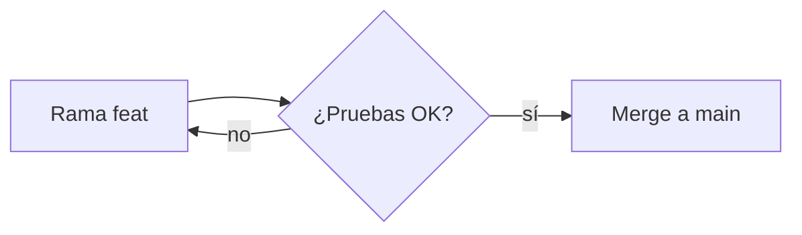

# Diagramas con Mermaid

GitHub dibuja diagramas escritos como texto en bloques `mermaid`:

````markdown

````

Funciona en README, issues, PRs y discusiones. Hay diagramas de flujo, de secuencia, de Gantt, de clases y `gitGraph` para dibujar ramas.

---

[← Volver al índice](../README.md)
